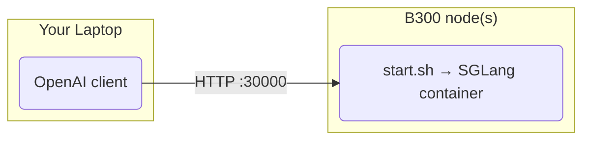

# Kimi K3 on SGLang (B300)

One-command SGLang deployment of [moonshotai/kimi-k3](https://huggingface.co/moonshotai/kimi-k3) on B300, serving an OpenAI-compatible API.

Recipe: [SGLang cookbook, Kimi-K3](https://docs.sglang.io/cookbook/autoregressive/Moonshotai/Kimi-K3).

## Architecture



## Quick start

Requires Docker + NVIDIA Container Toolkit on every node.

### Single node (8x B300)

```bash
./install_docker.sh   # one-time; skips anything already installed
cp .env.example .env  # optional; edit overrides
./start.sh            # streams the boot log, returns once /v1/models answers
./stop.sh
```

First boot downloads the weights into `~/.cache/huggingface` (override with `HF_CACHE`).

### 2 nodes (16x B300)

On every node, `cp .env.example .env` and set `NNODES=2`, `MASTER_ADDR=<node0-ip>` and `NODE_RANK` (0 on node0, 1 on node1). Then run `./start.sh` on rank 0 first, then on each worker within 10 minutes; rank 0 reports ready once all workers join.

```bash
NNODES=2 NODE_RANK=0 MASTER_ADDR=10.0.0.1 ./start.sh   # node 0 (serves the API)
NNODES=2 NODE_RANK=1 MASTER_ADDR=10.0.0.1 ./start.sh   # node 1
```

### 3 nodes (24x B300)

Same, with `NNODES=3` and ranks 0, 1, 2:

```bash
NNODES=3 NODE_RANK=0 MASTER_ADDR=10.0.0.1 ./start.sh   # node 0 (serves the API)
NNODES=3 NODE_RANK=1 MASTER_ADDR=10.0.0.1 ./start.sh   # node 1
NNODES=3 NODE_RANK=2 MASTER_ADDR=10.0.0.1 ./start.sh   # node 2
```

Note: nodes need to reach each other on `DIST_PORT` and `DIST_PORT+13` (the attention-DP port handshake; 20000 and 20013 by default) and over the high-speed fabric. Multi-node containers get `/dev/infiniband`, unlimited `memlock` and `IPC_LOCK` for RDMA, so the host needs working InfiniBand/RoCE (`ibv_devinfo`). Set `NCCL_SOCKET_IFNAME`/`NCCL_IB_HCA` if NCCL picks the wrong interface. The API is on rank 0 only.

### Restarting a multi-node deployment

Restarting any node means restarting all of them: `./stop.sh` on every node, then `./start.sh` on rank 0 first and on every worker within 10 minutes. Restarting only one node fails — the worker times out with "Failed to receive worker ports from node 0 within timeout", and rank 0 hangs waiting on the old worker.

### Layouts

| Nodes | GPUs | Parallelism |
|---|---|---|
| 1 | 8 | TP8, symm-mem |
| 2 | 16 | TP16, EP16, attn-DP2 |
| 3 | 24 | TP24, EP24, attn-DP3 |

### Settings (`.env` or shell env)

| Variable | Default | Description |
|----------|---------|-------------|
| `NNODES` | `1` | Node count: 1, 2 or 3 (TP = 8 * NNODES) |
| `NODE_RANK` | `0` | This node's rank, 0..NNODES-1 |
| `MASTER_ADDR` | unset | IP of the rank-0 node; required when `NNODES` > 1 |
| `DIST_PORT` | `20000` | Multi-node rendezvous port (`--dist-init-addr`); workers also connect on `DIST_PORT+13` (20013 by default) for the attention-DP port handshake |
| `NCCL_SOCKET_IFNAME` | unset | Network interface for NCCL (also set for GLOO) |
| `NCCL_IB_HCA` | unset | InfiniBand/RoCE HCAs for NCCL |
| `NCCL_DEBUG` | unset | NCCL log level (`INFO` shows the transport per link) |
| `GPU_ID` | `0,1,2,3,4,5,6,7` | The node's 8 GPUs |
| `HOST` / `PORT` | `0.0.0.0` / `30000` | API bind address (rank 0 only) |
| `MODEL_ID` | `moonshotai/kimi-k3` | HuggingFace model id |
| `SERVED_MODEL_NAME` | `kimi-k3` | Name the API serves the model under |
| `IMAGE` | `lmsysorg/sglang:latest` | SGLang image |
| `HF_CACHE` | `~/.cache/huggingface` | Host model cache |
| `HF_TOKEN` | unset | Optional; raises Hub rate limits |
| `MEM_FRACTION` | `0.82` (1 node) / `0.92` (2-3 nodes) | `--mem-fraction-static` |
| `CONTEXT_LENGTH` | unset | If set, `--context-length`; otherwise the model default |
| `SHM_SIZE` | `32g` | docker `--shm-size` |
| `EXTRA_ARGS` | unset | Extra SGLang flags, appended last |

`--reasoning-parser kimi_k3` splits thinking into `reasoning_content`; `--tool-call-parser kimi_k3` handles `tools` in the request.

## Test

```bash
curl http://localhost:30000/v1/chat/completions -H "Content-Type: application/json" \
  -d '{"model": "kimi-k3", "messages": [{"role": "user", "content": "Who won the world series in 2020?"}]}'
```

## Stop

`./stop.sh` on every node. To restart, stop all nodes first, then start rank 0 first (see above).

## Files

- `install_docker.sh`: installs Docker + NVIDIA Container Toolkit
- `start.sh` / `stop.sh`: run and stop the SGLang server (on every node)
- `.env.example`: optional overrides for `start.sh`
